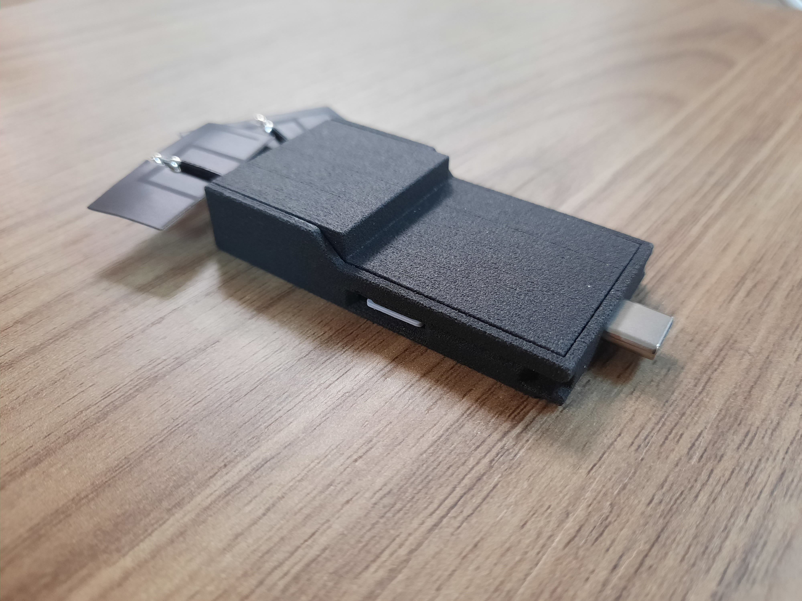
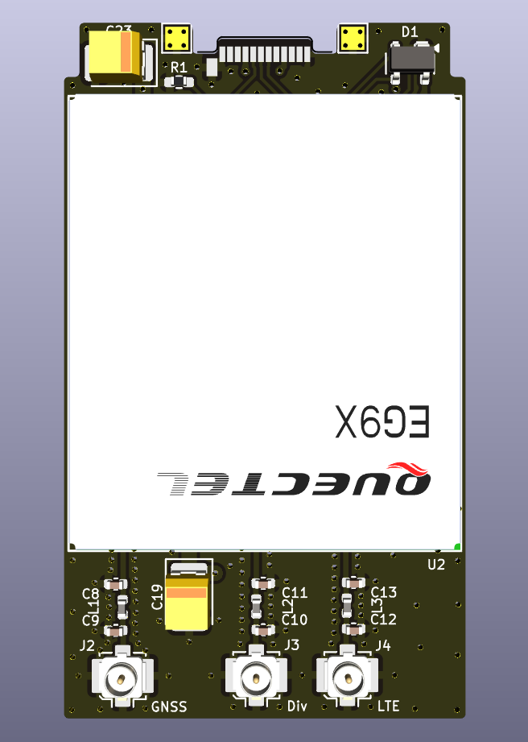
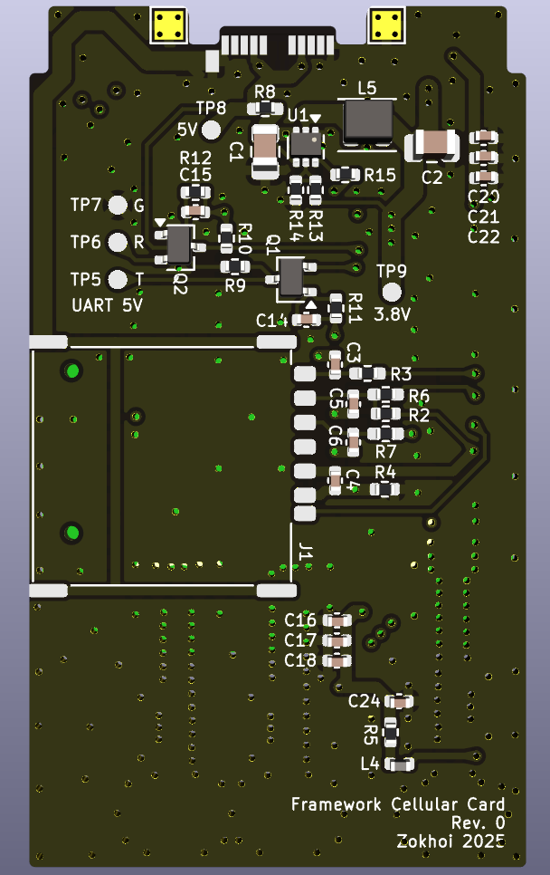

## Framework Cellular Expansion Card

Compatible with Quectel cellular modules with same pinout as BG96.

This PCB design has been tested with EG912U-GL and EG95-EX modules. Other modules with compatible pinout will need different component values in various positions, consult the relevant hardware design information for details.

This PCB design is in alpha state, therefore gerber will not be provided and you should only proceed ordering at your own risk.

There are multiple designs for use with external or SMD Antenna. The `usb-lte` design includes MHF-1 connectors for LTE main, diversity and GNSS, thus requiring 50 ohms impedance LTE antenna. The `usb-lte-chip-antenna` and `usb-lte-chip-antenna-q` design incorporates different SMD antenna, refer to their schematics for details.

The `usb-lte` PCB is 15mm longer than a regular expansion card PCB, with a preliminary case design provided. The `usb-lte-chip-antenna` design is 25mm longer and the `usb-lte-chip-antenna-q` design is 30mm longer to accomodate for the space required for the SMD antenna.

### Board specifications

Size 26mm x 45mm, thickness 0.8mm, 4 layers, copper thickness 1oz 0.5oz 0.5oz 1oz, impedance controlled board with 0.2mm prepreg

### Compatible modem series comparison

| Modem series | Cellular standards | Downlink speed | Uplink speed | Cost   |
|--------------|--------------------|----------------|--------------|--------|
| EG95         | 4G, 3G, 2G         | 150 Mb/s       |  50 Mb/s     | \$\$   |
| EG91         | 4G, 2G             |  10 Mb/s       |   5 Mb/s     | \$     |
| BG96         | Cat-M, Cat-NB1     | 375 Kb/s       | 375 Kb/s     | \$\$   |

### License
This hardware design is licensed under [CERN-OHL-W V2 or later](License.txt).

### Board preview

